<picture>
  <source media="(prefers-color-scheme: dark)" srcset="cards/dark/hero.svg">
  
</picture>

<picture>
  <source media="(prefers-color-scheme: dark)" srcset="cards/dark/now.svg">
  
</picture>

<picture>
  <source media="(prefers-color-scheme: dark)" srcset="cards/dark/stack.svg">
  
</picture>

<picture>
  <source media="(prefers-color-scheme: dark)" srcset="cards/dark/activity.svg">
  
</picture>

<picture>
  <source media="(prefers-color-scheme: dark)" srcset="cards/dark/oss.svg">
  
</picture>

<!--
  Cards are generated by scripts/render_cards.py and refreshed daily by
  .github/workflows/update-cards.yml. Edit data/profile.json to change the text.
-->
